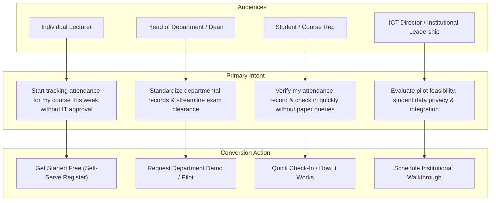

# Presently: Positioning-Led Information Architecture & Strategy

**Product:** Presently (University Attendance Management Platform)  
**Target Market:** Nigerian Universities, Polytechnics, and Colleges of Education  
**Document:** Strategic Information Architecture, User Journeys, and Content Hierarchy  
**Date:** November 2026

---

## 1. Strategic Positioning Statement

> **"Presently is a location-aware lecture attendance platform built specifically around the physical and infrastructural realities of Nigerian universities."**

### Core Positioning Pillars:
1. **Grounded in Reality, Not Startup Hype:** Born out of real lecture theatres at LASUSTECH. We do not pretend Nigerian campuses have high-speed 5G in every basement hall or that students never forget their phones. We engineered Presently to be resilient to these exact conditions.
2. **Pedagogical Focus:** Attendance should take 20 seconds, not 25 minutes of precious lecture contact time passed around on paper sheets.
3. **Transparent & Accountable:** We do not claim to "eliminate proxy attendance 100% with biometrics." We make proxy attendance practically infeasible by requiring simultaneous physical presence within a defined lecture hall radius during active sessions, backed by lecturer verification.
4. **Institutional Readiness:** Empowers HODs and Deans with clean, automated attendance percentages to satisfy faculty requirements and exam qualification rules (such as the standard 70–75% threshold) without end-of-semester paper reconciliation crises.

---

## 2. Audience Segmentation & Conversion Pathways



---

## 3. Recommended Homepage Information Architecture

The homepage is structured into 12 carefully sequenced narrative sections:

```
[01. Top Navigation & Audience Wayfinding]
       ↓
[02. Hero Section: Authentic Nigerian Campus Attendance]
       ↓
[03. Trust & Institutional Context Banner (Transparent Campus Testing)]
       ↓
[04. The Campus Reality: Why Paper Sheets Fail in 300-Seat Lecture Halls]
       ↓
[05. The Presently Workflow: 3 Simple Steps (Lecturer, Student, Admin)]
       ↓
[06. Interactive Product Showcase: Authentic System Interfaces]
       ↓
[07. The LASUSTECH Journey: Real Campus Roots & Engineering Lessons]
       ↓
[08. Multi-Audience Value Matrix (Lecturers, Students, HODs, Management)]
       ↓
[09. Engineering & Practical Safeguards (GPS Drift, Offline Tolerance, Privacy)]
       ↓
[10. Clear, Transparent Pricing (Starter, Lecturer Pro, Department, Institution)]
       ↓
[11. Campus FAQ: Real Answers to Real Infrastructure Questions]
       ↓
[12. Final Segmented Call-to-Action & Comprehensive Institutional Footer]
```

---

## 4. Section-by-Section Blueprint

### Section 01: Top Navigation
- **Left:** Presently Logo + Tagline badge ("University Attendance").
- **Center:** Product, How It Works, Campus Story, For Institutions, Pricing, FAQ.
- **Right:** 
  - Text link: `Sign In`
  - Secondary button: `Request Demo` (for Deans/HODs)
  - Primary button: `Start Free` (for Lecturers)

### Section 02: Hero Section
- **Kicker:** Built for Nigerian Tertiary Institutions.
- **Headline:** "Accurate lecture attendance. Built for the reality of Nigerian universities."
- **Sub-headline:** "Replace circulating paper sheets and manual roll calls with location-aware attendance. Lecturers create sessions in seconds; students verify their presence on their own phones."
- **CTAs:**
  - Primary: `Start Free as Lecturer` -> `/register`
  - Secondary: `Request Institutional Demo` -> `#institution-demo`
- **Visual Artifact:** Split-panel authentic UI preview:
  - Left: Lecturer Active Session Card (Course: CSC 301, Active PIN: `8492`, Geofence: 45m radius, Live counter: 87/94 checked in).
  - Right: Student Check-In Pass on Mobile Viewport (Verified inside Venue: FET LT-02, Timestamp: 10:14 AM).

### Section 03: Grounded Context Bar
- Replaces the fabricated social marquee.
- Transparent statement: *"Developed and field-tested in real academic lecture theatres at LASUSTECH. Engineered to operate reliably across fluctuating mobile data and diverse student devices."*

### Section 04: The Campus Reality (The Problem)
- Direct, relatable depiction of Nigerian university lecture halls:
  1. **The 45-Minute Paper Shuffle:** Attendance sheets circulating through 200+ students, interrupting the lecture and often getting lost or torn.
  2. **Rampant Proxy Signing:** Friends signing for absent coursemates, rendering paper registers statistically meaningless.
  3. **End-of-Semester Clearance Hell:** Lecturers and HODs spending days manually counting tick marks in physical notebooks to calculate the 75% exam qualification cutoff.
  4. **Record Vulnerability:** Single paper copies damaged by rain, misplaced by class reps, or altered after lectures.

### Section 05: How It Works by Role
- 3 clear tabs or segmented panels:
  - **For Lecturers:** 1) Choose course & set radius -> 2) Share 4-digit session code -> 3) Monitor live check-ins & export CSV.
  - **For Students:** 1) Open browser or app -> 2) Enter session code -> 3) Instant location check confirms presence.
  - **For HODs & Admins:** 1) View department courses -> 2) Track attendance trends -> 3) Export certified semester exam eligibility sheets.

### Section 06: Product Showcase (Verified System Capabilities)
- High-fidelity visual presentation of actual product modules:
  - **Module 1: Instant Session Control:** Geofence slider (15m to 150m), time-to-live countdown, dynamic PIN, and 1-tap manual student addition for device edge cases.
  - **Module 2: Frictionless Student Check-In:** Lightweight web access, zero heavy app installation required, immediate visual confirmation ticket.
  - **Module 3: Automated Exam Eligibility Matrix:** Dynamic calculation of student attendance percentages against faculty thresholds (70%/75%).
  - **Module 4: One-Click Departmental CSV/PDF Export:** Clean rosters formatted for Senate audit and faculty board meetings.

### Section 07: The LASUSTECH Journey (Our Story)
- Authentic narrative crafted with humility, rigor, and respect:
  - **Origins:** Conceived within the academic community at Lagos State University of Science and Technology (LASUSTECH) to solve real lecture hall crowding and attendance disputes.
  - **Real Campus Stress-Testing:** Tested across different halls, multi-story buildings, and network dead zones.
  - **Lessons Learned & Engineering Response:**
    - *Lesson 1: GPS attenuation in concrete halls.* Solution: Configurable geofence radius and manual lecturer verification fallback.
    - *Lesson 2: Uneven student device capabilities.* Solution: Zero-dependency mobile web interface that runs smoothly on budget Android devices.
    - *Lesson 3: Network latency drops during peak hours.* Solution: Lightweight payload architecture (<15KB check-in payload) ensuring instant submission even on 3G.
  - **Institutional Boundary Clause:** Transparent disclosure that field testing does not represent an exclusive institutional endorsement, but demonstrates practical, battle-tested utility.

### Section 08: Benefits by Academic Stakeholder
- Structured comparison grid addressing:
  - **Lecturers:** Reclaim 15–20 minutes of instruction time per class; zero paper grading burden.
  - **Students:** Transparent personal attendance records; no missing records caused by lost paper sheets.
  - **HODs & Exam Officers:** Instant verification of who has met the semester attendance threshold to sit for exams.
  - **University Leadership & ICT:** Modernize campus operations with secure, scalable software without purchasing expensive biometric hardware.

### Section 09: Trust, Data Privacy & Technical Transparency
- Honest architecture breakdown:
  - **Location Privacy Guarantee:** Geolocation is queried *only* at the precise moment of check-in to confirm venue proximity. Presently *never* tracks student location in the background or outside class hours.
  - **Device Independence:** Runs on standard smartphone browsers (Chrome, Safari) without requiring expensive flagship phones.
  - **Data Protection:** Encrypted data transit, isolated institutional tenant schemas, and strict lecturer authorization controls.
  - **Failsafe Measures:** Dedicated lecturer manual check-in override for students whose device battery died or whose GPS is uncalibrated.

### Section 10: Clear, Honest Pricing
- Transparent tiers matching actual product structure:
  - **Starter (Free Forever):** For individual lecturers getting started. 1 active course, full location-aware check-in, CSV export, up to unlimited sessions.
  - **Lecturer Pro (₦3,000 / month or ₦30,000 / year):** For active lecturers handling multiple courses. Unlimited courses, detailed attendance analytics, automated threshold alerts, priority support.
  - **Department (₦200,000 / year):** For academic departments standardizing attendance across up to 10 lecturers. Unified course dashboard, exam clearance reports, departmental admin console.
  - **Institution-wide (Custom Quote):** For faculties or entire universities. Campus-wide venue mapping, custom faculty hierarchy (Colleges/Faculties/Departments), LMS integration, on-site lecturer onboarding.

### Section 11: Campus FAQ (Addressing Real Objections)
- 8 definitive questions answered with complete technical honesty:
  1. *How does location verification work inside a classroom?*
  2. *What happens if a lecture hall has poor mobile network or weak GPS?*
  3. *What if a student’s phone battery dies or they don’t have a smartphone?*
  4. *Can students check in from their hostel or off-campus?*
  5. *Does Presently continuously track student location?*
  6. *How does this help with semester exam clearance?*
  7. *Can an individual lecturer use Presently without department approval?*
  8. *How can an institution pilot Presently?*

### Section 12: Final Conversion & Footer
- Dual action path:
  - Lecturers: `Create Free Account`
  - Deans/HODs: `Book a 15-Minute Institutional Demo`
- Comprehensive footer with legal policies (Terms, Privacy, Acceptable Use), product links, documentation, and contact channels.
