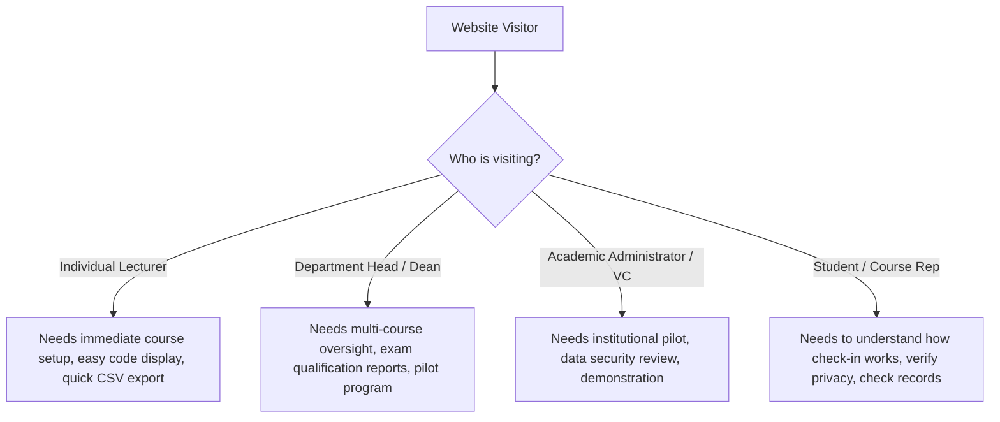

# Presently: Comprehensive UX/UI Audit & Brand Positioning Evaluation

**Target Website:** https://www.getpresently.com.ng/  
**Evaluation Date:** November 2026  
**Auditor:** Senior Product Designer & EdTech UX Strategist  
**Focus:** Visual identity, information architecture, messaging fidelity, audience segmentation, conversion friction, and institutional credibility.

---

## 1. Executive Summary

Presently is an attendance management platform built for the realities of Nigerian tertiary institutions. It originated within the Lagos State University of Science and Technology (LASUSTECH) academic community, where it was introduced, field-tested, and iterated against real lecture-theatre constraints (GPS fluctuation inside concrete buildings, spotty GSM/Wi-Fi connectivity, diverse Android/iOS hardware, and large class sizes).

However, an in-depth audit of the existing live landing page reveals a severe disconnect between the product’s genuine real-world value and its current digital presentation. 

Rather than leaning into its authentic Nigerian campus roots and practical engineering, the existing website suffers from **premature enterprise posturing**:
- Fabricated statistics (e.g., *"14+ Federal institutions"*, *"500k+ daily verified check-ins"*).
- Fake customer testimonials attributed to fictional university officials (*"Prof. Ifeanyi, Deputy Vice Chancellor"*, *"Musa Ibrahim, Registrar, ABU Zaria"*).
- Unsupported compliance and security claims (*"ISO 27001 certified"*, *"NUC audit was a breeze"*, *"Hardware-bound biometric handshake"*).
- Absolutist promises (*"Proxy attendance dropped to zero"*, *"Eliminate proxy attendance entirely"*).
- Generic Silicon Valley dark-mode SaaS aesthetics (excessive floating glowing orbs, decorative ungrounded mockups) that fail to convey institutional gravitas or Nigerian academic reality.

This repositioning audit establishes the baseline facts, catalogs existing defects, and defines the structural framework required to transform Presently into a credible, dependable, and high-converting academic platform.

---

## 2. Visual Identity & Brand Consistency Audit

| Dimension | Current State | Assessment & Critical Deficiencies | Recommended Direction |
| :--- | :--- | :--- | :--- |
| **Color Palette** | Sungold (`#F9C406`), Charcoal (`#231F0F`), Soft Cream (`#FDF9F0`), Dark Charcoal (`#161616`). | The gold and deep charcoal core palette has strong potential and distinctiveness. However, the current implementation over-indexes on high-contrast neon glows, vibrating borders, and distracting animated orbs that scream "crypto/fintech app" rather than academic institution. | Ground the palette: Keep the signature Sungold as an authoritative, deliberate accent. Introduce warm academic stone, clean slate grays, and crisp crisp architectural white. Eliminate glowing neon orbs. |
| **Typography** | `Outfit` (sans) and `Plus Jakarta Sans` / `Lexend`. | The typography is modern but set with hyper-tight line-heights (`leading-[0.9]`), excessive italicization of single words for stylistic flair (`"verified."`, `"academic leadership."`), and overly large display clamp sizes that break ungracefully on medium screens. | Introduce clear academic hierarchy. Pair a sturdy, readable geometric headline face with highly legible body typography designed for prolonged reading and data scanning on modest mobile screens. |
| **Elevation & Surfaces** | Skewed cards, 3D mouse tilt (`perspective-2000`, `rotateX`, `rotateY`), floating glassmorphism. | The 3D tilt effects on cards feel gimmicky and create visual noise that degrades readability. The skeuomorphic buttons with heavy gold drop-shadows look out of place on modern web platforms. | Clean structural borders (`1px border-neutral-200 dark:border-neutral-800`), subtle tonal layering, and tactile physical feedback without cartoonish 3D tilting. |
| **Imagery & Assets** | Pravatar stock images for fake professors; abstract charts; ungrounded mockups. | Stock photos of arbitrary individuals undermine credibility immediately when reviewed by Nigerian academics who recognize that neither the names nor faces match their institutional faculties. | Replace all synthetic avatars with authentic lecturer and student workflow illustrations, verified system UI screenshots, and transparent feature demonstrations. |

---

## 3. Navigation & Information Architecture (IA)

### Current Structure:
- Brand Logo
- Primary Links: `Features`, `Mobile App`, `Pricing`, `Blog`
- Utility Actions: `Log in`, `Get started free`

### Critical Deficiencies:
1. **Lacks Institutional Wayfinding:** The top navigation treats all users as generic B2C consumers looking for a mobile app. There is no route for Deans, HODs, or ICT Directors seeking institutional trials or department pilots.
2. **Missing Story / Context:** There is zero mention of the LASUSTECH journey or how Presently came to be, forfeiting the single most defensible and relatable story the company has.
3. **Misleading Section Names:** "Mobile App" suggests a mandatory native download, when Presently operates seamlessly as a responsive progressive web app (PWA) with direct browser check-in.
4. **Poor Scroll Anchors:** Several header links point to internal IDs that jump abruptly without orienting the user across the actual workflow.

---

## 4. Messaging, Claims & Trust Signals: The 10 Constraint Violations

The most urgent requirement of this repositioning is correcting claims that violate the project brief and degrade institutional trust:

| Constraint | Current Landing Page Text | Violation Analysis | Rectification Plan |
| :---: | :--- | :--- | :--- |
| **1. Product Capabilities** | *"Biometric handshake: On-device hardware-backed authentication ensures the identity is immutable."* | Presently does not currently run hardware-level biometrics on mobile web check-in. Claiming this invites immediate disqualification during technical audits. | Focus on real, verified mechanisms: GPS geofencing radius, time-limited dynamic session PINs, active browser session validation, and lecturer manual override controls. |
| **2. Customer & Adoption Stats** | *"Trusted by 14+ federal institutions"*, *"500k+ daily verified check-ins"* | Invented adoption numbers. Misrepresents an early-stage, growing product and creates legal/reputational risk. | Remove fabricated stats. Replace with authentic product throughput metrics (e.g., average check-in speed: <5 seconds; batch session export in 1 click). |
| **3. ISO Certification** | *"ISO 27001 certified data storage"* | Claiming ISO certification without verifiable third-party certification evidence damages credibility. | State actual infrastructure practices: encrypted HTTPS data transit, secure cloud databases, role-based access control, and student data privacy protection. |
| **4. Unsupported Security Claims** | *"High-fidelity triangulation... Wi-Fi signal signatures... AES-256 institutional data lake"* | Tech-buzzword salad. Wi-Fi signature sniffing is not supported on web browsers without native enterprise MDM profiles. | Accurately explain location verification: HTML5 Geolocation API, distance threshold calculation against lecturer lecture coordinates, and accuracy tolerance buffers. |
| **5. Proxy Attendance Promise** | *"Eliminate proxy attendance and institutional chaos"*, *"Proxy attendance dropped to zero"* | Impossible claim. No attendance technology can eliminate 100% of proxies without invasive biometric hardware. | Position as *"Dramatically curtail proxy attendance"*; explain how location verification makes remote proxy signing impractical. |
| **6. Implemented vs Planned** | Blurs current PWA check-in with theoretical enterprise data lakes and predictive AI grading. | Confuses prospective buyers and frustrates current lecturers. | Explicitly tag features: Core (Available Now) vs Departmental Pilots vs Roadmap. |
| **7. Regulatory Endorsement** | *"NUC compliant attendance system"*, *"The NUC audit was a breeze"* | NUC (National Universities Commission) does not certify software products directly. Implies official regulatory endorsement. | Reframe around academic standards: *"Designed to support university guidelines and minimum attendance thresholds (such as the standard 70%–75% semester requirement)."* |
| **8. Substantiated Claims** | Logos of *"Fut minna, Unilag, Abu zaria, Ui ibadan, Oau ife"* in the footer marquee. | Unauthorized use of federal university brands without formal enterprise contracts. | Remove unauthorized university crests/names. Highlight authentic testing in academic lecture halls and real lecturer feedback. |
| **9. Tone & Voice** | High-flown Silicon Valley venture jargon: *"Ecosystem governance"*, *"Sovereign sync"*, *"Fidelity rating"*. | Alienates Nigerian lecturers who want practical tools that work during power outages and slow network connections. | Use clear, authoritative, practical Nigerian academic language that addresses real lecture halls, large classes, and exam qualification sheets. |
| **10. Institutional Identity** | Total omission of LASUSTECH origins in favor of a synthetic "global enterprise" disguise. | Hides the authentic human story of origin and practical problem-solving. | Dedicate a prominent section to the LASUSTECH journey: how real lecture hall tests shaped the platform’s fault-tolerant design. |

---

## 5. Audience Segmentation & User Journeys

Currently, all visitors are directed toward a single generic action: *"Get started free"* -> `/register`. This fails all 4 primary personas:

### Gap Analysis:
1. **Lecturers** do not see how fast it is to create a session (takes under 30 seconds).
2. **Deans & HODs** find no information on faculty-wide aggregation, department course rosters, or official exam clearance sheets.
3. **Students** feel surveilled rather than empowered because the page does not clarify that location is checked *only* at the split-second of check-in, not continuously tracked.
4. **Institutional buyers** have no dedicated *"Schedule Institutional Demo"* or *"Request Pilot Proposal"* pathway.

---

## 6. Conversion Friction & CTA Placement

1. **Vague CTAs:** *"Get started free"* and *"Claim your audit"* provide no preview of the onboarding steps. Lecturers fear entering complex institutional setup flows.
2. **No Interactive Product Preview:** The hero mockup contains fake static tabs that don’t demonstrate the real check-in screen or the lecturer's session dashboard.
3. **Pricing Obscurity:** The pricing shows "₦3,000/month" for Pro and "₦200k/year" for Department, but fails to clearly distinguish what is free forever for an individual lecturer versus when an upgrade is actually required.
4. **Missing Self-Service Demo:** No sandbox or guided walk-through of the lecturer session creation flow.

---

## 7. Mobile Responsiveness & Accessibility Audit

- **Touch Target Sizes:** Several accordion toggles and footer links are smaller than 40px, failing WCAG 2.1 AA touch target guidelines (minimum 44x44px).
- **Network Payload:** Unnecessary motion libraries and unoptimized SVG/canvas scripts degrade load performance on 3G/4G connections common across Nigerian university campuses.
- **Contrast Ratios:** Muted text (`text-white/20`, `text-neutral-400` on cream backgrounds) fails the 4.5:1 contrast ratio required for normal body text.
- **Screen Reader Support:** Missing `aria-expanded` and `aria-controls` on key accordion questions; decorative SVGs lack `aria-hidden="true"`.

---

## 8. Summary Triage Matrix: Retain, Improve, Remove, Introduce

| Category | Retain | Improve | Remove | Introduce |
| :--- | :--- | :--- | :--- | :--- |
| **Brand Assets** | Core Presently wordmark, Sungold primary accent, Deep charcoal base. | Contrast ratios, button typography, responsive padding. | Floating animated orbs, 3D card tilt, glassmorphism blur traps. | Clean stone cards, academic badge tags, verified product status indicators. |
| **Content & Copy** | Core mission: location-aware attendance for Nigerian universities. | Hero headline, value propositions, FAQ answers, pricing descriptions. | Fake testimonials, ISO claims, NUC endorsement claims, 14+ federal university claims. | LASUSTECH origin story, real campus constraint learnings, real workflow walk-throughs. |
| **Product UI** | Real system components (sessions, courses, check-ins). | Mockup clarity: show authentic session PIN generation, student check-in modal, CSV export. | Synthetic charts with fake line graphs and unlabelled percentages. | Step-by-step Lecturer, Student, and HOD walkthroughs with realistic Nigerian course codes (e.g. CSC 301, MTH 101). |
| **Conversion** | Free starter option for lecturers. | Distinct CTAs: "Start as Lecturer" vs "Request Campus Demo". | "Claim your audit" (meaningless for software). | Transparent Institutional Pilot Request form, FAQ tackling real GPS/network doubts. |
