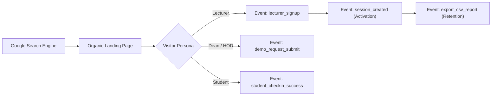

# Presently: Analytics, Conversion Tracking & Measurement Plan

**Document:** Organic Search Analytics, Measurement Architecture & KPI Governance  
**Product:** Presently (https://www.getpresently.com.ng/)  
**Date:** November 2026

---

## 1. Analytics Architecture Overview

SEO success must be measured by **commercial and pedagogical impact**, not vanity page views. An increase in organic traffic is meaningful only if it results in active lecturer registrations, verified lecture sessions, and qualified departmental pilot inquiries.

---

## 2. Google Search Console (GSC) Configuration

### 2.1 Property Setup & Verification
- **Primary Domain Property:** `getpresently.com.ng` (DNS TXT verification via domain registrar). Captures search performance across all subdomains and protocols.
- **URL-Prefix Property:** `https://www.getpresently.com.ng/` (HTML meta tag verification). Used for sitemap submission and precise URL inspection.

### 2.2 Search Query Performance Segmentation
Configure custom GSC performance filters to track the organic acquisition funnel:

| Query Segment | Regex Filter Pattern | Focus Metrics | Growth Objective |
| :--- | :--- | :--- | :--- |
| **Brand Queries** | `presently\|getpresently\|presentlyapp` | Impressions, Clicks, CTR | Brand awareness growth; monitor SERP title accuracy. |
| **Product / Category Queries** | `university attendance\|lecture attendance\|attendance software\|attendance system` | Average Position, Impressions | Achieve Top 5 ranking in Nigeria within 90 days. |
| **Problem / Informational Queries** | `proxy attendance\|paper register\|exam clearance\|attendance rule` | CTR, Landing Page Engagement | Capture top-of-funnel academic researchers and lecturers. |
| **Institutional / Regional Queries** | `attendance nigeria\|attendance lagos\|lasustech attendance` | Clicks, Conversions | High-intent lead generation for campus pilots. |

---

## 3. Google Analytics 4 (GA4) Event Taxonomy

The measurement ID `G-78VRQFZFKQ` is integrated into `index.html`. In a Single Page Application (SPA), default page views must be triggered on virtual route changes, complemented by granular custom conversion events:

### 3.1 Custom Event Definitions

| Event Name | Trigger Condition | Parameters Tracked | Conversion Category |
| :--- | :--- | :--- | :---: |
| `page_view` | Virtual route transition via React Router | `page_title`, `page_location`, `page_path` | Engagement |
| `lecturer_signup` | User successfully completes `/register` form | `method` (`email`, `google`), `source_page` | **Primary Conversion** |
| `demo_request_submit` | Institutional demo form submitted | `institution_name`, `official_email_domain` | **Primary Conversion** |
| `session_created` | Lecturer successfully launches a class session | `course_code`, `venue_radius`, `duration` | **Activation KPI** |
| `student_checkin_success` | Student completes GPS verified check-in | `course_code`, `accuracy_meters`, `latency_ms` | Product Utility |
| `export_csv_report` | Lecturer or admin downloads attendance CSV | `course_code`, `records_count`, `export_type` | Retention KPI |
| `faq_toggle` | User expands an accordion question | `question_text`, `section` | Content Depth |

---

## 4. Key Performance Indicators (KPIs) & Target Benchmarks

| Metric | Current Baseline (Month 0) | Month 1 Target | Month 3 Target | Month 6 Target | Tracking Platform |
| :--- | :---: | :---: | :---: | :---: | :---: |
| **Indexed Organic Pages** | 19 (incl. 404s & doorways) | 12 (clean canonicals) | 24 (high-value pillars) | 40+ | Google Search Console |
| **Monthly Organic Clicks (NG)** | < 50 | 250 | 1,200 | 4,000 | Google Search Console |
| **Non-Brand Search Impressions** | < 1,000 | 5,000 | 25,000 | 80,000 | Google Search Console |
| **Organic Lecturer Signups** | Baseline | 20 / month | 80 / month | 250 / month | GA4 (`lecturer_signup`) |
| **Institutional Demo Inquiries** | Baseline | 3 / month | 10 / month | 25 / month | GA4 (`demo_request_submit`) |
| **Average Organic Engagement Rate** | ~35% | > 55% | > 65% | > 70% | Google Analytics 4 |
| **Mobile Core Web Vitals (LCP)** | ~2.8s | < 2.2s | < 1.8s | < 1.5s | PageSpeed / CrUX |

---

## 5. Review Cadence & Reporting Rhythm

1. **Weekly Operational Check (30 mins):**
   - Check GSC Index Coverage for crawl anomalies, 404 spikes, or indexation drops.
   - Review top organic landing page conversion rates in GA4.
   - Inspect query position movements for core Tier 1 commercial keywords.
2. **Monthly Strategic Review (60 mins):**
   - Branded vs. non-branded traffic ratio evaluation.
   - Organic conversion cohort analysis: How many signups launched an active session within 7 days?
   - Content performance review: Measure organic traffic generated by newly published blog articles.
3. **Quarterly Technical & Competitive Audit:**
   - Full site crawl using automated audit tools to detect broken internal links or redirect chains.
   - Competitor SERP movement review for higher education queries in Nigeria.
