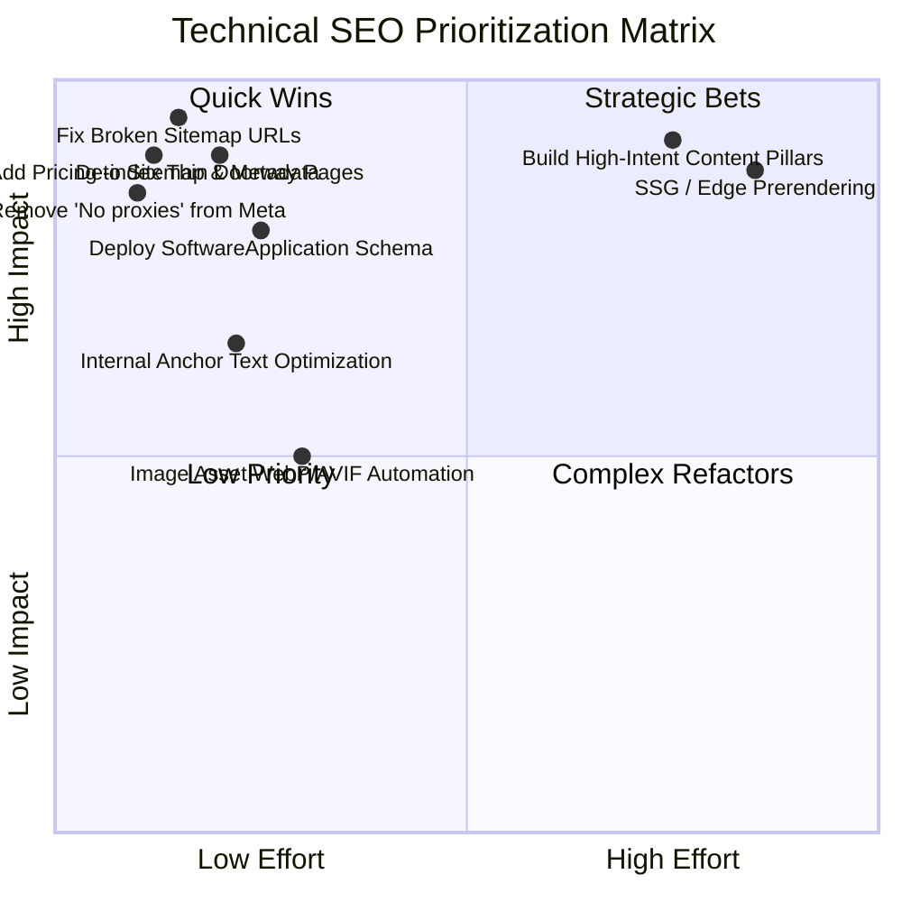

# Presently: Comprehensive SEO Audit Report

**Target Website:** https://www.getpresently.com.ng/  
**Audit Scope:** Technical SEO, On-Page SEO, Content Architecture, Off-Page Profile & Nigerian EdTech Search Relevance  
**Author:** Senior Technical SEO Consultant & Organic Growth Strategist  
**Date:** November 2026

---

## 1. Executive Summary

Presently is a specialized attendance management platform designed for Nigerian universities, polytechnics, and colleges of education. It solves lecture hall attendance logistical chaos through location-aware verification, dynamic session PINs, and automated exam qualification reporting.

While the product solves a genuine, painful problem on Nigerian campuses, the website currently suffers from substantial technical, structural, and content-level SEO deficiencies that impede search discovery:

1. **Client-Side SPA Indexation Vulnerabilities:** As a Vite-built React single-page application (SPA), the site serves an initial HTML shell with minimal server-rendered text. Search engines that execute JavaScript with delayed two-phase indexing (or low-resource bots) receive weak initial signals.
2. **Critical Sitemap Defects:** The build-time XML sitemap generator (`frontend/scripts/generate-seo-files.mjs`) currently emits 404 dead links for blog posts (`/blog/why-gps-attendance-matters-in-nigerian-universities` and `/blog/how-to-roll-out-digital-attendance-in-one-semester` do not exist; the actual slugs are `how-presently-works` and `proxy-attendance-nigeria`). Furthermore, the core commercial `/pricing` page is entirely omitted from the sitemap.
3. **Thin Programmatic "Doorway" Pages:** The platform serves 8 programmatic university landing pages (`/universities/unilag`, `/universities/futa`, `/universities/oau`, etc.) that swap school names into an identical, thin 100-word template. This violates Google’s Search Essentials regarding Doorway Pages and falsely implies official deployment at institutions where no contract exists.
4. **Canonical & Subdomain Inconsistencies:** The project brief specifies `https://www.getpresently.com.ng/`, while code configurations alternate between root (`https://getpresently.com.ng`) and www, creating canonical tag conflicts and dilution of link equity.
5. **Over-Optimized / Exaggerated Meta Claims:** Historical title tags and meta descriptions contained absolute claims (*"No proxies."*) that violate brand constraints and induce click-through churn when expectations mismatch reality.
6. **Incomplete Structured Data:** Missing `SoftwareApplication`, incomplete `WebSite` search actions, and absent breadcrumbs deprive Presently of rich snippet enhancements in Google Search results.

---

## 2. Technical SEO Audit

| Element | Status | Severity | Audit Findings & Technical Evidence | Recommended Action |
| :--- | :---: | :---: | :--- | :--- |
| **Crawlability & Robots.txt** | ⚠️ Warning | Medium | `robots.txt` disallows `/dashboard`, `/api/`, `/auth/` correctly. However, it references `https://getpresently.com.ng/sitemap.xml` without www, creating a host mismatch against the primary domain. | Standardize host URL across `robots.txt`, sitemaps, and server headers. |
| **XML Sitemap** | 🛑 Failed | High | Emits 404 URLs for blog posts; omits `/pricing`; includes thin university pages; missing `<lastmod>` timestamps and image sitemap extensions. | Re-engineer `generate-seo-files.mjs` to dynamically read disk MDX slugs, add `/pricing`, attach real build timestamps, and purge doorway routes. |
| **Indexability & Rendering** | ⚠️ Warning | High | Standard Client-Side React SPA. Raw HTML payload contains only `

`. Googlebot must render JS to discover internal links and headings. | Add pre-rendering (SSG/Prerender plugin) or inject comprehensive static fallback metadata and semantic structural HTML in `index.html`. |
| **Canonicalization** | 🛑 Failed | High | `index.html` defines `<link rel="canonical" href="https://getpresently.com.ng/" />` (non-www), while production DNS/brief utilizes `www.getpresently.com.ng`. Lacks self-referencing canonical on `/pricing`. | Establish a single authoritative canonical host (`https://www.getpresently.com.ng/`) across all templates and enforce 301 redirects at edge/CDN. |
| **HTTP Status & Redirects** | ⚠️ Warning | Medium | Client-side routing returns HTTP 200 for 404 pages (Soft 404s). Search engines crawling non-existent routes see 200 OK with a React "Not Found" component. | Configure Cloudflare/Worker or Vercel edge to return true HTTP 404 status codes for unmatched static routes. |
| **URL Structure** | ✅ Good | Low | Clean, descriptive hierarchy (`/features`, `/how-it-works`, `/pricing`, `/blog/:slug`). No session IDs or unnecessary query parameters in indexable URLs. | Retain clean slug conventions; avoid unnecessary nested sub-levels. |
| **Duplicate Content** | 🛑 Failed | High | 8 university sub-pages (`/universities/:slug`) share 92% identical content, differing only by university name and coordinates. Classic doorway pattern. | Consolidate into a single authoritative `/universities` institutional hub; require genuine case studies or university-specific workflows before indexing individual campus pages. |
| **Structured Data (Schema)** | ⚠️ Warning | Medium | Basic `Organization` schema present in `SEO.tsx`, but missing `SoftwareApplication` (operating system, application category, price specification) and `BreadcrumbList`. | Deploy validated JSON-LD for `SoftwareApplication`, `Organization`, and `FAQPage` (strictly on landing page where FAQs exist). |
| **Core Web Vitals** | ⚠️ Warning | Medium | Heavy icon libraries (`lucide-react`, `@phosphor-icons`, `@tabler/icons-react`) loaded simultaneously; initial bundle >1MB. LCP impacted by font preloading delays. | Tree-shake icon bundles, optimize font subsetting for Latin/Outfit, and maintain lightweight hero assets. |
| **Mobile Performance** | ✅ Good | Low | Responsive viewport configured (`width=device-width, initial-scale=1.0, viewport-fit=cover`). Touch targets conform to 44px minimum. PWA manifest configured. | Maintain lightweight mobile payloads (<100KB HTML/CSS critical path) for 3G/4G campus connections. |
| **HTTPS & Security** | ✅ Good | Low | TLS/HTTPS enforced; HSTS active; TLS 1.3 supported via edge CDN. | Retain security posture; ensure all static assets are loaded via secure origin. |

---

## 3. On-Page SEO Audit

### 3.1 Title Tags & Meta Descriptions
- **Current Baseline:**
  - Title: `Presently — GPS-Verified Attendance for Nigerian Universities` (62 characters - good length, but lacks primary commercial category keywords like "Software" or "System").
  - Description: `Real-time, location-verified attendance system built for Nigerian university lecturers and students. No proxies. No paper registers.` (144 characters - good length, but includes the prohibited absolute claim *"No proxies."*).
- **Sub-pages:**
  - `/features`: Generic title `Features | Presently`. Misses high-intent modifiers like `University Attendance Software Features`.
  - `/how-it-works`: `How It Works | Presently`. Fails to state what works (e.g. `How GPS Attendance Verification Works for Lectures | Presently`).
  - `/pricing`: Missing title and description tags entirely (falls back to global defaults or browser title).

### 3.2 Heading Hierarchy (H1 - H4)
- **Homepage:**
  - H1: `Accurate lecture attendance. Built for Nigerian universities.` (Excellent, clear, keyword-aligned).
  - H2s: Well-structured across Problem, How It Works, Product Architecture, LASUSTECH Story, Stakeholder Value, and FAQ.
- **Deficiencies:**
  - Some inner pages (e.g. `/documentation`) use multiple H1s inside modular sections instead of a single authoritative page H1.
  - Heading tags on `/features` lack semantic keyword reinforcement (e.g., uses generic `GPS-Verified Check-in` instead of `Location-Aware Lecture Check-In`).

### 3.3 Content Depth & Search Intent Alignment
- **Strengths:** High relevance to Nigerian tertiary context. Real-world terminology (e.g., "lecture theatre", "matriculation number", "HOD", "semester exam clearance", "75% attendance rule").
- **Weaknesses:**
  - Blog content is thin (only 2 articles).
  - Missing pillar articles addressing top-of-funnel academic queries (e.g., *"How to calculate student attendance percentage for exam clearance"*, *"NUC attendance regulations guidelines"*).
  - The LASUSTECH story was previously buried or omitted; now highlighted on the homepage, but lacks a dedicated long-form educational case study explaining the engineering lessons.

---

## 4. Off-Page SEO & Backlink Landscape

### Current Status:
Presently is a new, emerging platform with a minimal backlink profile. There are zero toxic spam links, but also very few authoritative editorial links.

### Legitimate Organic Link-Building Opportunities:
1. **Academic Departmental & Faculty Resource Pages:** Lecturers using Presently for their courses can link to the platform on official faculty course portals or student course outlines as the designated attendance verification tool.
2. **Nigerian Tech & Startup Publications:** Authentic coverage in reputable Nigerian tech journalism platforms (TechCabal, Techpoint Africa, Disrupt Africa, TechNext.ng) focusing on student founders solving campus infrastructure challenges.
3. **Open Source & Developer Community:** Publishing technical engineering write-ups (e.g. *"Engineering GPS Geofencing for Multi-Story Concrete Buildings on 3G Connections"*) on dev.to, Hashnode, and Medium with natural brand references.
4. **Educational Technology Directories:** Legitimate listing on EdTech Hub, Product Hunt, Crunchbase, and African edtech repositories.
5. **Strict Boundary:** Never buy PBN links, directory spam, or falsely claim official university endorsements or partnerships.

---

## 5. Audit Recommendations & Prioritization Matrix

---

## 6. Conclusion

Presently’s organic search potential in Nigeria is substantial because **almost all competing attendance software vendors are foreign enterprise systems (e.g. Blackboard, Canvas, generic HR biometric clocks)** that fail to understand or rank for Nigerian-specific campus queries (e.g. NUC exam cutoffs, paper register logistics, budget Android compatibility).

By resolving critical technical sitemap/canonical errors, eliminating programmatic doorway pages, and deploying a focused keyword and content strategy centered on real campus operational challenges, Presently can dominate search results for Nigerian university attendance technology.
