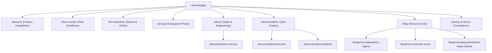
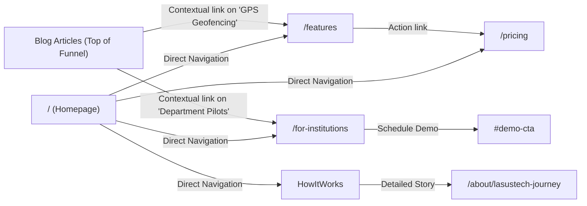

# Presently: Search-Optimized Website Information Architecture

**Document:** URL Taxonomy, Structural Hierarchy & Internal Linking Blueprint  
**Product:** Presently (https://www.getpresently.com.ng/)  
**Date:** November 2026

---

## 1. Architectural Strategy & Search Intent Mapping

Presently’s search architecture is structured to eliminate thin content, avoid cannibalization, and route search visitors directly to the exact page answering their intent:

---

## 2. Page-by-Page URL Taxonomy & Intent Blueprint

| URL Path | Primary Search Intent | Target Persona | Primary Target Keyword | Unique Value & Content Scope |
| :--- | :---: | :---: | :--- | :--- |
| `/` | Commercial / Navigational | All Audiences | `university attendance management system` | Comprehensive product overview; Nigerian campus context; live interactive preview; dual conversion paths. |
| `/features` | Commercial / Informational | Lecturers & HODs | `university attendance software features` | Technical breakdown of GPS boundary validation, dynamic PIN security, student rosters, and CSV exports. |
| `/how-it-works` | Informational | Lecturers & Students | `how digital attendance works in university` | Chronological step-by-step walkthrough across Lecturers, Students, and Department Heads. |
| `/for-institutions` | Transactional | Deans, HODs, ICT Directors | `university attendance system Nigeria` | Enterprise/faculty pilot proposal; exam qualification automation; multi-department administrative console; demo request form. |
| `/pricing` | Transactional | Lecturers & HODs | `attendance software pricing Nigeria` | Clear tiers (Free Starter, ₦3,000/mo Pro, ₦200,000/yr Department, Custom Institutional); plan limits; feature matrix. |
| `/about/lasustech-journey` | Informational / Brand | Academic Decision-Makers | `presently attendance lasustech` | Objective narrative of campus origins; engineering lessons on concrete hall GPS attenuation, device disparities, and network congestion; institutional boundary disclaimer. |
| `/documentation` | Support / Informational | Active Users & Evaluators | `presently user guide documentation` | Technical documentation, onboarding walkthroughs, FAQs, and API integration guides. |
| `/blog` | Informational / Educational | Broader Academic Community | `nigerian higher education attendance articles` | Curated editorial resource hub addressing paper register failures, exam clearance regulations, and campus digital transformation. |
| `/privacy` | Legal / Trust | Students & Data Officers | `student attendance data privacy policy` | Explicit declaration: point-in-time check only, zero background tracking, encrypted data transit, no third-party data selling. |
| `/terms` | Legal / Governance | Institutional Users | `presently terms of service` | Standard SaaS terms of service, acceptable use policies, and lecturer/institution responsibilities. |

---

## 3. Consolidation & Deprecation of Programmatic Doorway Pages

### 3.1 The Problem with Existing `/universities/:slug` Routes
The repository historically generated eight programmatic routes:
- `/universities/lasustech`
- `/universities/unilag`
- `/universities/lasu`
- `/universities/futa`
- `/universities/oau`
- `/universities/ui`
- `/universities/uniport`
- `/universities/uniben`

These pages have identical content, simply substituting the university name, founded date, and student population.

### 3.2 Strategic SEO Remediation
1. **Immediate De-indexing:** Remove `/universities/:slug` routes from `sitemap.xml` immediately.
2. **Apply Noindex:** Add `<meta name="robots" content="noindex, follow" />` to `UniversityLandingPage.tsx` to stop search engines from indexing doorway variations.
3. **Consolidation into `/for-institutions`:** Direct institutional traffic to an authoritative `/for-institutions` landing page.
4. **Authorized Institutional Case Study Protocol:** In the future, a dedicated campus sub-page (e.g. `/case-studies/lasustech`) should only be published when:
   - Written authorization is obtained from the university/faculty.
   - Genuine, documented qualitative and quantitative case study data exists.
   - The content is 100% unique, containing verified lecturer interviews, specific venue configurations, and verified semester metrics.

---

## 4. Internal Linking Architecture & Equity Distribution

Internal links pass authority ("PageRank") and provide contextual relevance to search bots:

### Internal Linking Rules:
- **Descriptive Anchor Text:** Never use generic "click here" or "read more". Always use keyword-rich, contextual anchor text (e.g., *"explore our location-aware attendance features"* or *"review departmental pilot requirements"*).
- **Breadcrumb Navigation:** Implement semantic BreadcrumbList structured data across all sub-pages (`Home > Documentation > Lecturer Guide`) to assist Googlebot in understanding parent-child relationships.
- **Topical Clustering:** Every blog article must include at least two contextual internal links to relevant core pages (`/features`, `/how-it-works`, or `/pricing`).
