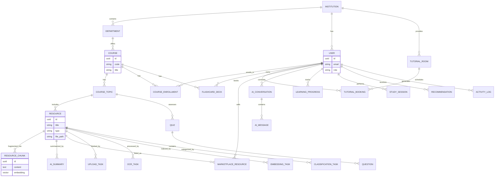
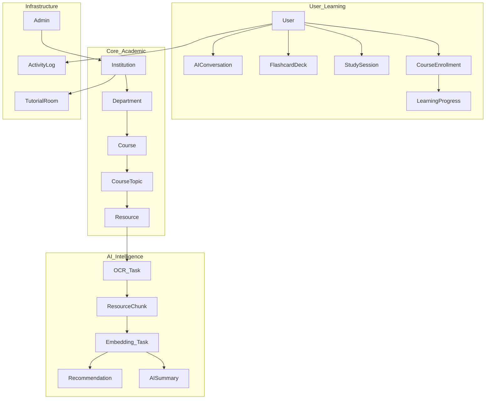
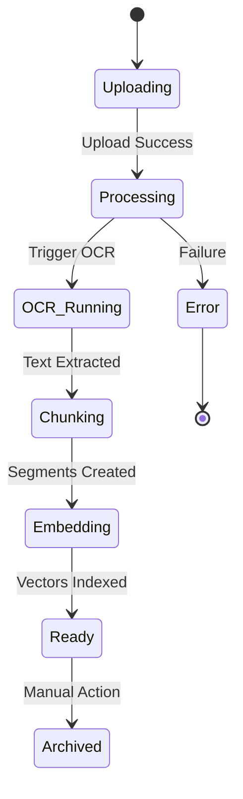
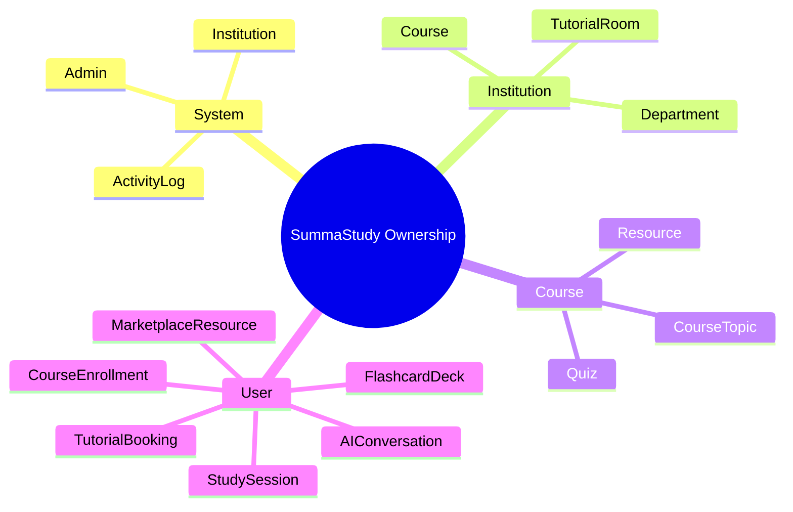
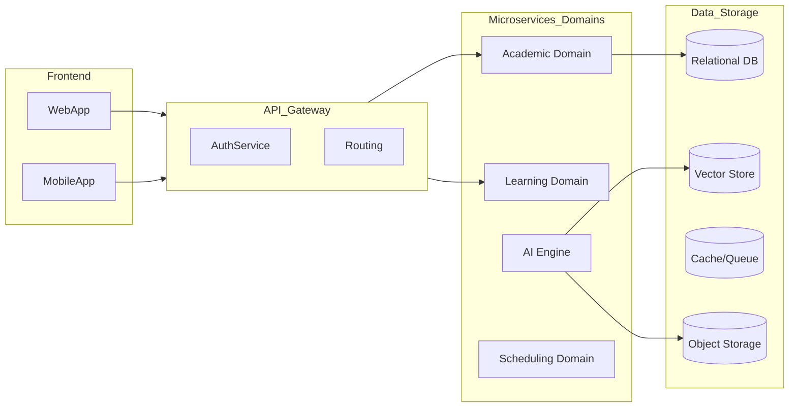
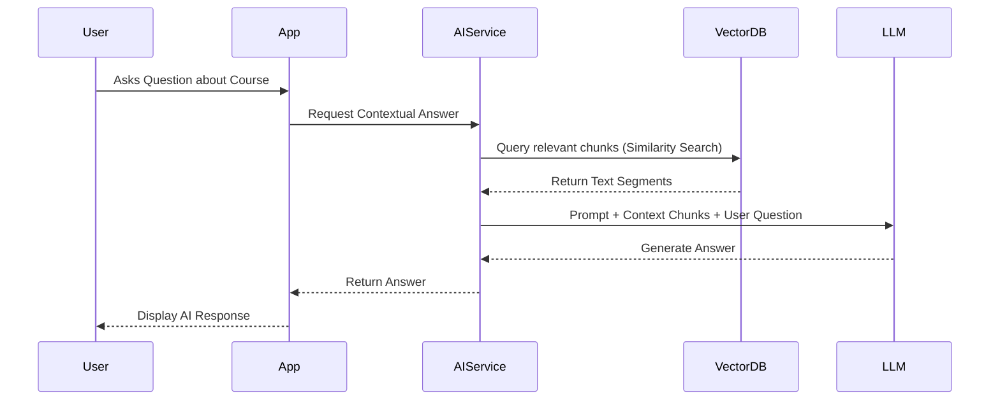
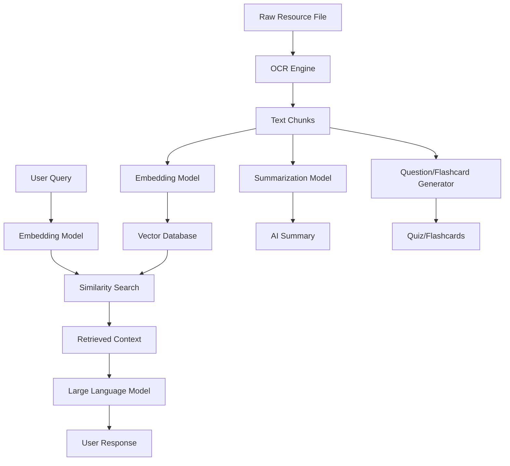
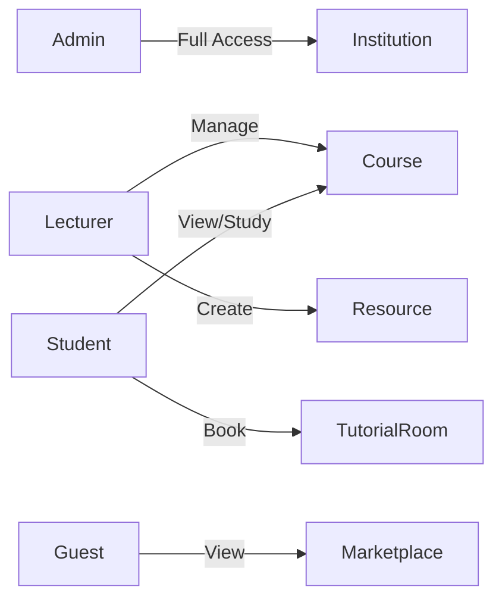

# SummaStudy Architecture Diagrams

This document contains visual representations of the SummaStudy architecture using Mermaid.

## 1. Full ERD

## 2. Domain Map

## 3. Entity Lifecycles (Example: Resource)

## 4. Ownership Map

## 5. Modular Architecture Map

## 6. Data Flow Architecture (RAG)

## 7. AI Integration Architecture

## 8. Permission Matrix (Overview)

